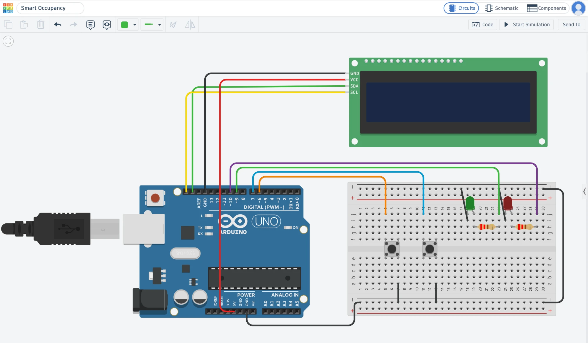
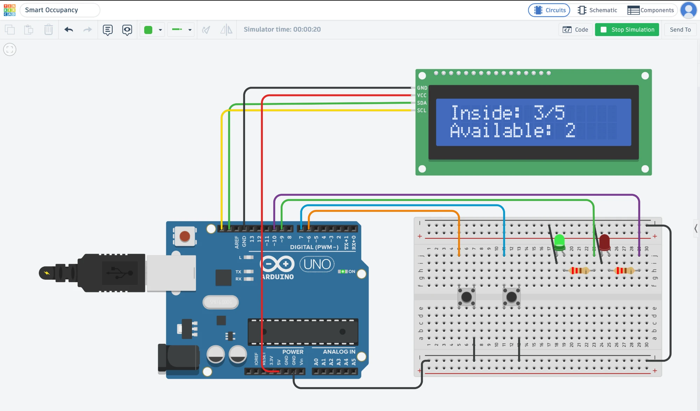

# ALU Programming in C - Summative

Five projects for the Programming in C summative: one Arduino system simulated in Tinkercad, one Bash script, and three C programs. Each project lives in its own folder with its own README that explains how to build it, how it works, where each required concept is used, and how errors are handled.

## Projects

| # | Project | Language | Main concepts | Run |
|---|---------|----------|---------------|-----|
| 1 | [Smart Occupancy Monitoring and Access Control System](Smart%20Occupancy%20Monitoring%20and%20Acess%20Control%20System/README.md) | Arduino C++ (Tinkercad) | structures, pointers, `calloc`/`free`, non-blocking `millis()` timing, button debouncing, I2C LCD, serial commands | Paste `occupancy_monitor.ino` into a Tinkercad circuit and start the simulation |
| 2 | [Linux System Health and Resource Monitoring Manager](Linux%20System%20Health%20and%20Resource%20Monitoring%20Manager/README.md) | Bash | CPU, memory and disk monitoring, process search and termination, health reports, activity log | `./monitor.sh` (Linux only) |
| 3 | [Student Academic Records and Performance Analytics System](Student%20Academic%20Records%20and%20Performance%20Analytics%20System/README.md) | C | structures, pointers, `malloc`/`realloc`/`free`, linear search, bubble sort, file save and load | `make && ./records` |
| 4 | [Sales Transaction Processing and Analysis System](Sales%20Transaction%20Processing%20and%20Analysis%20System/README.md) | C | function pointer array, callbacks for filtering and sorting, dynamic arrays, file handling | `make && ./sales` |
| 5 | [Multi-threaded Document Search and Analysis System](Multi-threaded%20Document%20Search%20and%20Analysis%20System/README.md) | C (POSIX threads) | one `pthread_create` per file, `pthread_join`, per-thread result structs, one report per file | `make && ./document_analyzer "IoT" document1.txt document2.txt document3.txt` |

## Requirements

- **Project 1:** a free Tinkercad account (Circuits). No hardware needed.
- **Project 2:** a Linux system, for example Ubuntu. On macOS or Windows, run it in a container:

  ```bash
  docker run --rm -it -v "$PWD":/work -w /work ubuntu bash
  ```

- **Projects 3, 4 and 5:** `gcc` and `make`. Every C project builds with `-Wall -Wextra -std=c11` and zero warnings. Project 5 also needs `-pthread`, which its Makefile already adds.

## Repository layout

```
Smart Occupancy Monitoring and Acess Control System/        Project 1
Linux System Health and Resource Monitoring Manager/        Project 2
Student Academic Records and Performance Analytics System/  Project 3
Sales Transaction Processing and Analysis System/           Project 4
Multi-threaded Document Search and Analysis System/         Project 5
docs/                                                       Screenshots of every project running
```

## Screenshots

All screenshots are in [`docs/`](docs). File names start with the project number.

**Project 1 - Smart Occupancy Monitoring (Tinkercad)**

| Circuit | Start: 0 inside, green LED on |
|---------|-------------------------------|
|  |  |
| **Counting: 3 inside, 2 places left** | **Full: red LED on, entry refused** |
|  |  |

**Project 2 - System Health Monitor**

| Screenshot | Shows |
|------------|-------|
| [p2_01_menu.png](docs/p2_01_menu.png) | Main menu |
| [p2_02_system_info.png](docs/p2_02_system_info.png) | System information |
| [p2_03_cpu.png](docs/p2_03_cpu.png) | CPU usage and threshold |
| [p2_04_memory.png](docs/p2_04_memory.png) | Memory usage |
| [p2_05_disk.png](docs/p2_05_disk.png) | Disk usage |
| [p2_06_processes.png](docs/p2_06_processes.png) | Process list and search |
| [p2_07_report.png](docs/p2_07_report.png) | Health report |

**Project 3 - Student Records**

| Screenshot | Shows |
|------------|-------|
| [p3_01_menu.png](docs/p3_01_menu.png) | Main menu |
| [p3_02_register.png](docs/p3_02_register.png) | Registering a student |
| [p3_03_display_all.png](docs/p3_03_display_all.png) | All students |
| [p3_04_search.png](docs/p3_04_search.png) | Search |
| [p3_05_sort.png](docs/p3_05_sort.png) | Sort |
| [p3_06_report.png](docs/p3_06_report.png) | Performance report |

**Project 4 - Sales Transactions**

| Screenshot | Shows |
|------------|-------|
| [p4_01_menu.png](docs/p4_01_menu.png) | Main menu |
| [p4_02_add.png](docs/p4_02_add.png) | Adding a transaction |
| [p4_03_display_all.png](docs/p4_03_display_all.png) | All transactions |
| [p4_04_function_pointers.png](docs/p4_04_function_pointers.png) | Process Sales Data through the function pointer array |
| [p4_05_filter_callback.png](docs/p4_05_filter_callback.png) | Filtering with a callback |
| [p4_06_report.png](docs/p4_06_report.png) | Sales report |

**Project 5 - Document Analyzer**

| Screenshot | Shows |
|------------|-------|
| [p5_01_processing.png](docs/p5_01_processing.png) | Threads processing three files and the summary |
| [p5_02_report_file.png](docs/p5_02_report_file.png) | A generated report file |

## AI usage disclosure

AI assistance was used for two things only:

- **Mock data:** the sample input files used to test and demonstrate the programs, such as `sample_students.txt` (Project 3), `sample_transactions.txt` (Project 4) and `document1.txt` to `document3.txt` (Project 5).
- **Documentation:** help with writing and formatting the README files.
